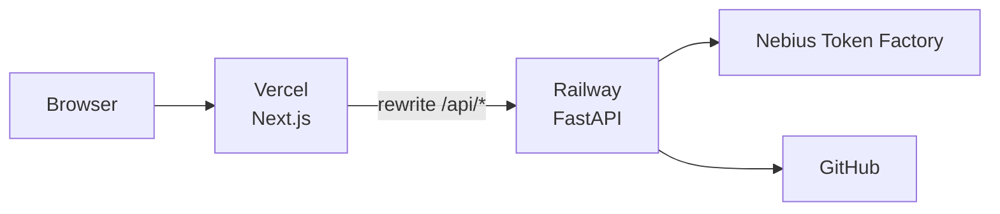
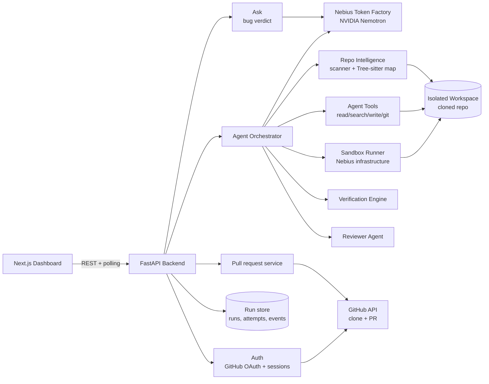
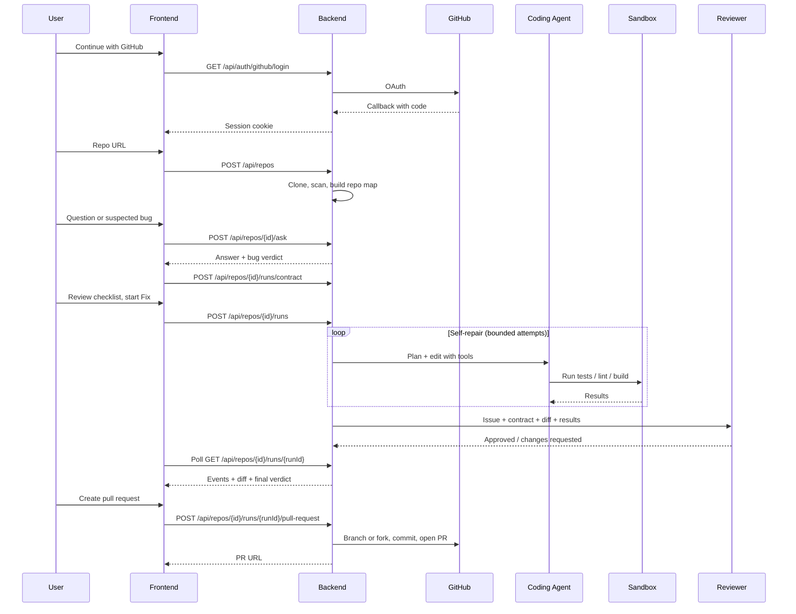

# PatchPilot Architecture

PatchPilot is an autonomous coding agent. A signed-in user connects a GitHub repository,
confirms a bug through Ask, and hands it to Fix. Fix patches the code, runs it in a sandbox,
repairs its own failures, and reports success only when a verification contract and an
independent reviewer agent both approve. The user then opens a pull request.

The phase-by-phase build plan lives in [`phases.md`](phases.md).

## Platform

| Part | Host | Role |
| ---- | ---- | ---- |
| Frontend | Vercel | Next.js app; the only origin the browser talks to |
| Backend | Railway | FastAPI API, repo intelligence, agent, sandbox runner |
| Models | Nebius Token Factory | NVIDIA Nemotron |
| Code host | GitHub | OAuth sign-in, cloning, pull requests |



- Next.js rewrites `/api/*` to the backend URL (`BACKEND_URL`), so the browser sees one site
  and the session cookie is first-party. Locally the rewrite is off and the frontend calls the
  backend directly (`NEXT_PUBLIC_API_BASE_URL`).
- The GitHub OAuth callback points at the frontend (`<frontend>/api/auth/github/callback`) and
  reaches the backend through the same rewrite.
- Railway starts `uvicorn` with a `/health` check (`backend/railway.json`); `git` is installed
  for cloning (`backend/railpack.json`).
- Sessions, connected repositories, and runs live in backend memory and reset on redeploy.
- When Docker is not available on the backend host, a run finishes as **unverified** rather
  than verified.

## System diagram



## Request lifecycle

1. **Sign in.** The user continues with GitHub. The backend completes OAuth, stores the
   session server-side, and sets the session cookie. Every route except `/health` and
   `/api/auth/*` requires it.
2. **Connect.** The user pastes a repository URL. The backend clones it into an isolated
   workspace and builds a repo map.
3. **Ask.** The user asks about the code or describes a suspected bug. Ask answers from the
   repository and ends with a verdict: `BUG_CONFIRMED` with a one-line summary, or `NO_BUG`.
   A missing or garbled verdict counts as not confirmed.
4. **Hand-over to Fix.** A confirmed bug opens Fix with the summary and Ask's findings, and
   the orchestrator drafts a **Verification Contract** for the user to review. Fix stays
   locked until Ask confirms a bug or the user picks **Fix anyway**.
5. **Fix.** The coding agent plans, selects files, and edits code through tools. The sandbox
   runs install / test / lint / build; failures feed the **self-repair loop**. The
   verification engine checks the contract and the **reviewer agent** challenges the patch.
   Every step is recorded as a run event that the dashboard polls into its timeline.
6. **Pull request.** From a finished run (verified or unverified) the user opens a PR as
   themselves. Repos they can push to get a branch directly; others are forked first. The
   commit is built through the Git Data API, so nothing is pushed from the shallow clone.



## Components

| Component | Location | Responsibility |
| --------- | -------- | -------------- |
| Dashboard | `frontend/app/`, `frontend/components/` | Sign-in gate, repo explorer, Ask, Fix run view, diff, pull request panel |
| API client | `frontend/lib/api.ts` | Typed calls to the backend |
| `/api` rewrite | `frontend/next.config.ts` | Forwards `/api/*` to `BACKEND_URL` when set |
| API routes | `backend/app/api/` | Thin handlers: validate, delegate, shape the response |
| Auth | `backend/app/auth/` | GitHub OAuth, session store, signed-in guard |
| Config | `backend/app/config.py` | Single settings object loaded from the root `.env` |
| LLM client | `backend/app/llm/` | Nebius Token Factory calls, model routing, retries, error mapping |
| Repo intelligence | `backend/app/repo/` | Clone, scan, stack detection, repo map, retrieval, Ask |
| Agent | `backend/app/agent/` | Orchestrator loop, planner, tools, prompts |
| Sandbox | `backend/app/sandbox/` | Allow-listed command execution in Docker with resource limits |
| Verification + reviewer | `backend/app/agent/verification.py` | Contract generation, checking, independent patch review |
| Run store | `backend/app/agent/runs.py` | Runs, attempts, events |
| Pull requests | `backend/app/pr/` | Collect run changes, branch or fork, open the PR on GitHub |

## Model routing

| Role | Used for | Setting |
| ---- | -------- | ------- |
| `planner` | Planning, verification contract, review | `MODEL_PLANNER` (Nemotron Ultra) |
| `worker` | Edits, summaries, simple prompts | `MODEL_WORKER` (smaller Nemotron) |
| `reviewer` | Independent patch review | `MODEL_REVIEWER` (defaults to `MODEL_PLANNER`) |

## Error handling

- Provider failures raise a typed `LLMError` inside the backend.
- Handlers map them to `503` (provider not configured) or `502` (provider request failed)
  with a generic message. Raw provider responses, stack traces, and keys never reach the client.
- Retryable statuses (`429`, `5xx`) and transport errors are retried with exponential backoff.

## Security boundaries

- Secrets come only from the root `.env` (or the host's settings on Vercel and Railway);
  `.env.example` holds placeholders.
- Every API route except `/health` and `/api/auth/*` requires a signed-in session.
- The user's GitHub OAuth token stays server-side in the session store; the browser only holds
  a random session cookie. An OAuth state cookie binds the callback to the browser that
  started the login.
- Pull requests are opened with the signed-in user's token, so PatchPilot can only push where
  that user can.
- Agent file tools are confined to the run's workspace (path-traversal guard).
- The sandbox runs allow-listed commands only, with CPU, memory, time, and network limits.
- The reviewer agent receives the issue, contract, diff, and results — not the coder's reasoning.

## Repository layout

```
PatchPilot/
├── frontend/          # Next.js (TypeScript, App Router, Tailwind) — Vercel
│   ├── app/
│   ├── components/
│   ├── lib/
│   └── next.config.ts # /api rewrite
├── backend/           # FastAPI (Python) — Railway
│   ├── app/
│   │   ├── main.py
│   │   ├── config.py
│   │   ├── api/
│   │   ├── auth/
│   │   ├── llm/
│   │   ├── repo/
│   │   ├── agent/
│   │   ├── sandbox/
│   │   └── pr/
│   ├── tests/
│   ├── railway.json
│   └── railpack.json
├── architecture.md
├── phases.md
├── .env.example
└── README.md
```
